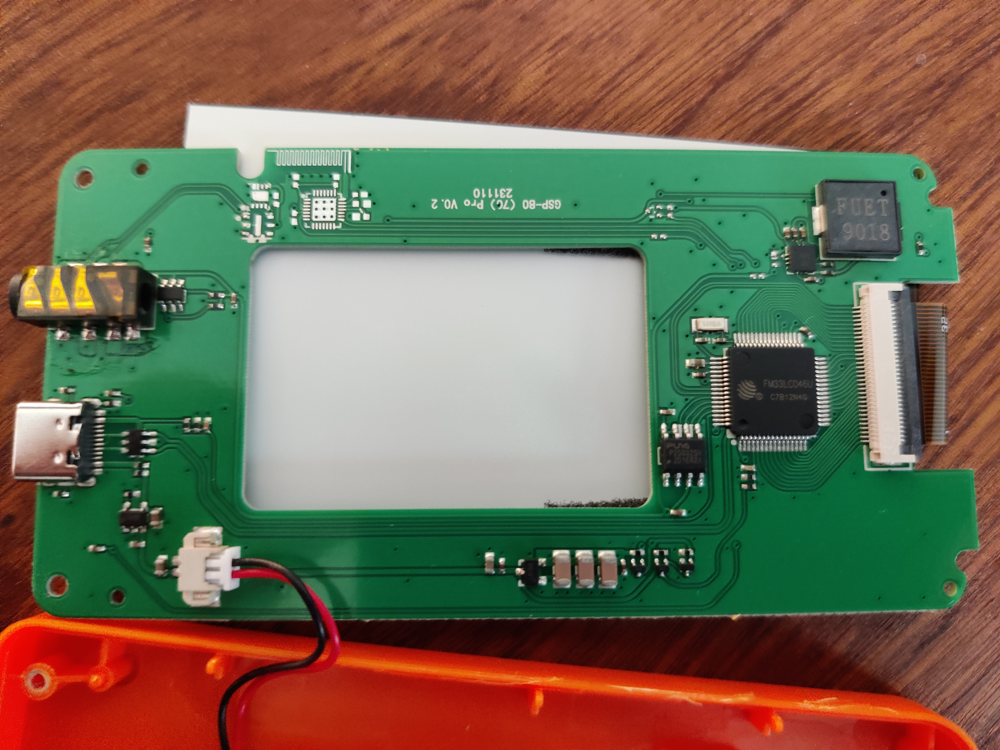
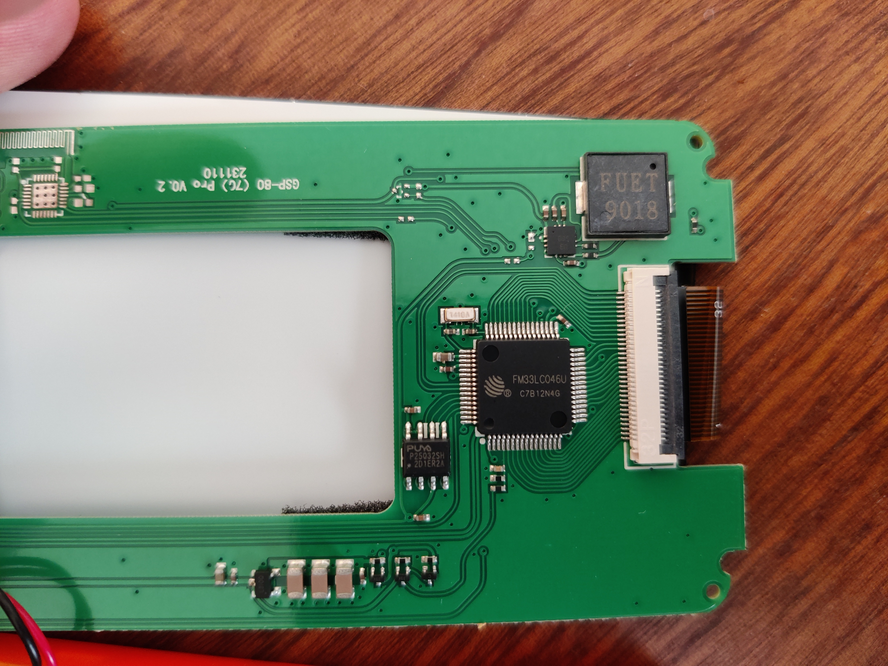
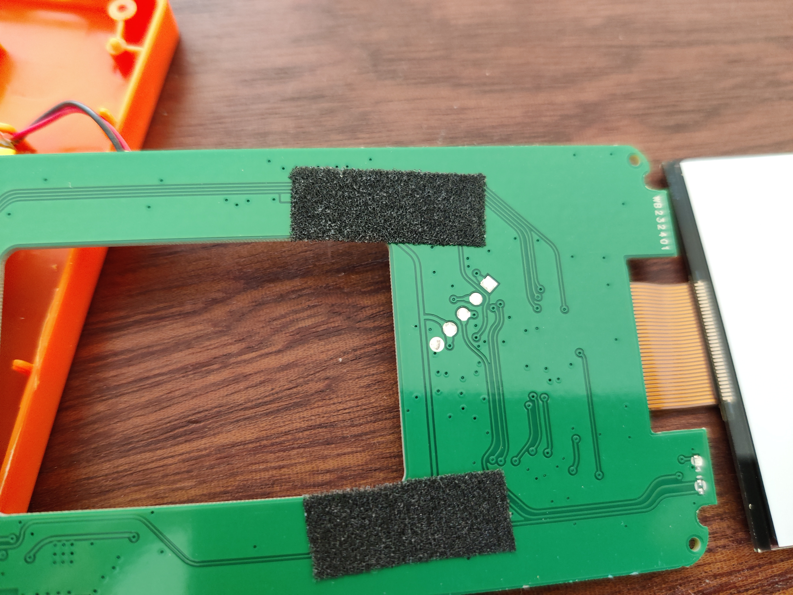

# GSP-70 / GSP-80 internals

Technical notes from reverse engineering the **AIKESI / CHNADKS GSP-80S** logger: hardware,
on-drive file formats, the configuration protocol, firmware layout, SWD access and power
management. Everything was worked out from the device's USB behaviour and a dump of its
firmware; no vendor software was used. For using the tools, see the [README](../README.md). For the device's buttons and screen, see [MANUAL.md](MANUAL.md).

## Model variants: what is known

Only **GSP-80S** units were examined. Evidence about the other variants:

* **GSP-80S vs GSP-80Pro (same board, likely).** The GSP-80S board is silkscreened
  "GSP-80 (7C) Pro V0.2", and the sensor plugs into the TRRS jack on both, so the S and Pro
  probably differ only in the probe/housing. Not confirmed on a Pro unit.
* **GSP-80 vs GSP-70 (same firmware, strong evidence).** This one firmware image supports
  both models and **auto-detects the probe**: at runtime it sends command `0xF3` to a
  temperature+RH sensor (`0x105ac`; `0xF3` is the HTU21/SHT2x-style "measure temperature"
  command) and, failing that, probes a temperature-only sensor (`0x10d80`). The result
  selects `GSP-80` / `TEMP+RH` or `GSP-70` / `TEMP` in the PDF, the `bm8a` / `bm8b`
  header in `get.txt`, and the `rad.txt` layout (code at `0xa45a`, `0x4602`). The "(7C)"
  on the silkscreen may refer to the GSP-70 too. A GSP-70 unit has not been examined, so
  its board and probe hardware are unconfirmed.

## Debug / research tools

| Tool | Purpose |
|---|---|
| `tools/swd_halt.py` | Halt the MCU over SWD before the firmware disables the debug port |
| `tools/disasm.py` | Capstone-based Thumb disassembly helpers for the firmware dump |
| `tools/sgio.py` | Minimal raw SCSI (SG_IO) helper used while probing the USB interface |

These need the project venv (`uv venv .venv && uv pip install --python .venv/bin/python pyocd capstone`).

## Device overview

| Item | Detail |
|---|---|
| MCU | Fudan Micro **FM33LC046U** (ARM Cortex-M0, 256 KB flash, 24 KB RAM, USB FS, segment-LCD driver) |
| Storage | PUYA **P25Q32SH** 4 MB SPI NOR. First `0x350000` bytes = FAT12 volume exposed over USB; the rest holds settings, calibration and records |
| USB | `464d:0402` "AKS AIKESI-USB-LOG", **mass storage only** (SCSI "AIKESI NorFlahDriver") |
| Other | FUET 9018 buzzer, TRRS probe jack, unpopulated QFN + PCB antenna (wireless variant?) |





### Files on the USB drive

| File | Attr | Written by | Content |
|---|---|---|---|
| `<serial>-<track>.pdf` | | device | Report (written as `tmp.pdf` then renamed) |
| `get.txt` | hidden | device | 192-byte summary + settings line (see below) |
| `rad.txt` | hidden | device | Raw records (see below) |
| `calp.txt` | hidden | device | Current calibration, only if calibration has been set |
| `cn1.txt`, `cn2.txt` | | **you** | Change settings / set clock |
| `stp.txt` | | **you** | Content `stp`: stop recording (software stop) |
| `clr94.txt` | | **you** | Content `clr94`: reset (zeroes the track counter) |
| `adj.txt` | | **you** | Content `adj`: purpose not yet known |
| `cal.txt` | | **you** | Starts `TEMP`: write calibration (format not yet decoded) |

The volume is wiped when a new recording is saved.

**When command files are processed:** the firmware scans for them when USB power
appears (before the drive enumerates) **and when USB is unplugged**. Each recognised
file is read (max 64 bytes) and deleted. Unknown names (e.g. `set.txt`) are ignored.

## `get.txt` format

```
bm8a-50000,log00250,  25,002,y,mkt 17.9,avr 17.9, 73.9,max 18.9, 79.9,min 17.0, 70.6,D261107,154930,  <- header (computed)
L 30,W040-10,9535,K0Uc,S00600,261107,160525,P1A1,Ne03000929{null}                                     <- settings string
```
(one line in the real file, NUL-padded to 192 bytes)

Header:

| Field | Meaning |
|---|---|
| `bm8a-50000` / `bm8b-50000` | Detected probe type: `bm8a` = temperature+RH (GSP-80), `bm8b` = temperature only (GSP-70). Re-evaluated at runtime, so a unit can briefly report `bm8b` if the RH probe fails to answer |
| `log%05d` | Number of records |
| `%4d` | Number of rows in `rad.txt` (records / 10, rounded up) |
| `%03d` | Track code: counter, bumped on each recording / settings change, zeroed by `clr94.txt` |
| status letter | Stop reason byte stored at SPI `0x350204`: `s` software (`stp.txt`), `k` key/button, `f` memory full, `u` power/battery (unconfirmed); otherwise `y`/`n` (a recording-active flag, exact semantics unconfirmed) |
| `mkt / avr / max / min` | Mean kinetic temperature, average, max, min (temp, then RH) |
| `D<YYMMDD>,<HHMMSS>` | Printed in the PDF as "Stop Time", but **unreliable** (often not the real stop time; `D1071531,316362` = never set). Use the last record's timestamp instead |

## Settings string (shared by `get.txt` and `cn1.txt`)

The firmware locates each field with `strchr()` (first occurrence of the key letter)
and reads fixed character offsets after it; numbers are parsed with `atoi()`, so
leading spaces/zeros are fine.

| Field | Width | Example | Meaning |
|---|---|---|---|
| `L` | 3 | `L 30` | Record interval in **units of 10 s** (`30` = 300 s). Minimum 1 |
| `W` | 3 + 3 | `W040-10` | Temperature alarm **high**, **low** (signed, 3 chars each, in the selected unit) |
| (after `W`, comma) | 2 + 2 | `9535` | RH alarm **high**, **low** (%) |
| `K` | 1 | `K0` | **Button stop**: `0` = enabled, otherwise disabled |
| `U` | 1 | `Uc` | **Temperature unit**: `f` = °F, otherwise °C. Applies to the display, PDF **and `rad.txt` values**. Alarm limits are *not* converted: re-set them in the new unit |
| `S` | 5 | `S00600` | **Start delay** in seconds |
| (after `S`) | 6,6 | `261107,160525` | Start time of the last recording; overwritten by the firmware at start, so send `000000,000000` |
| `P` | 1 | `P1` | **Button (key) tone**: `1` = enabled |
| `A` | 1 | `A1` | **Alarm tone**: `1` = enabled |
| `N` | | `Ne03000929` | Serial number. **First character selects PDF language**: lowercase = English, uppercase = Chinese |
| `{...}` | | `{null}` | **Track mark** shown in the PDF |

Hardware-verified: interval, start delay, clock, unit, button tone, alarm tone (PDF),
track mark. Decoded from firmware but not yet tried on a unit: button stop, language letter.

The PDF always reports Start Mode "Button" and Stop Mode "Button+Software+Memory Full";
this firmware has no timed-start or alternative stop modes.

## Changing settings: `cn1.txt` and `cn2.txt`

```
cn1.txt:  D261108,161555,L  6,W008002,7535,K0Uc,S00010,000000,000000
cn2.txt:  000P1A1Ne03000642{null}
```

* **`cn1.txt`**: optional `D<YYMMDD>,<HHMMSS>` sets the clock (fixed offsets after `D`);
  everything from the first `L` becomes the new settings string.
* **`cn2.txt`**: chars 0–2 ignored, chars 3–6 = `P<x>A<y>`, char 7 onward =
  `N<serial>{<track mark>}`. If the file is 45 chars or longer it is cut to 44 and
  closed with `}`, so the mark can be about 25 chars.
* The firmware stores `cn1[from 'L'] + "," + cn2[3:7] + "," + cn2[7:]`, re-parses it,
  saves it (MCU flash, A/B slots) and regenerates `get.txt`.
* `cn2.txt` **overwrites the serial number**: always copy it from the unit's own
  `get.txt` (the tool does this).

Both files are needed: `cn2.txt` is only read if `cn1.txt` exists and contains an `L`.

## Raw data: `rad.txt`

```
S0001D26-11-07 18.9 71.0 18.7 71.4 ...    row 1 / first row of a new day: 'D' + date (no time)
S0002C16:55:24 18.3 70.6 18.3 70.9 ...    'C' + time of the row's first sample
...
S0025C12:05:24 18.0 76.3 ... 17.9 73.8$   file ends with "$\r\n"
```

* Each row is one fixed block in SPI flash: 4-byte timestamp + 20 × 16-bit values,
  whatever the interval. The last row may be partial.
  * **GSP-80** (`bm8a`): temp, RH alternating, so **10 samples per row** (verified).
  * **GSP-70** (`bm8b`): every value is a temperature, so **20 samples per row** (from the
    firmware's formatting code at `0x7498`; no real file seen yet).
  The layout can't be told from `rad.txt` alone, so `rad2csv.py` uses the `get.txt` header.
* Temperatures are in the logger's selected unit (°C or °F; see `U` in `get.txt`).
* Values are fixed 5-character fields (`" 18.9"`, `"-46.9"`) and can run together.
* Raw encoding: temperature = `(raw − 468) / 10` °C, RH = `raw / 10` %.
* **Firmware bug:** rows past the end of the data are read from erased flash
  (`0xFFFF` → `-46.9` / `655.3`, dates like `107-15-31`). The PDF shows the same garbage.
  Use the record count from `get.txt` (`log%05d`) to trim.
* `get.txt`'s start time is consistently 1 s later than the `rad.txt`/PDF timestamps.

`tools/rad2csv.py` handles all of this: it rebuilds a timestamp for every sample,
checks every `C` row against a fixed interval, drops the garbage, and writes:

```
record,timestamp,temp_C,rh_pct
1,2026-11-07 16:05:24,18.9,71.0
2,2026-11-07 16:10:24,18.7,71.4
```

## Memory capacity

The firmware stops recording when the record count reaches **99,990** (check at `0xf564`;
it then stores stop reason `F`, shown as "Memory Full" in the PDF and `f` in `get.txt`).
There is no wrap-around. Time until full = 99,990 × interval:

| Interval | Time until memory is full |
|---|---|
| 10 s (minimum) | 11.6 days |
| 30 s | 34.7 days |
| 1 min | 69.4 days (≈ 2.3 months) |
| 2 min | 139 days (≈ 4.6 months) |
| 5 min | 347 days (≈ 11.4 months) |
| 10 min | 1.9 years |
| 15 min | 2.9 years |
| 30 min | 5.7 years |
| 1 h | 11.4 years |
| 9,990 s (maximum, ≈ 2.8 h) | 31.7 years |

At intervals above about 5 minutes the battery (roughly 9–12 months reported) runs out
first. Storage isn't the limit: 99,990 GSP-80 records are 9,999 blocks × 44 bytes ≈ 440 KB,
well within the ~700 KB of SPI flash beyond the FAT volume. The memory-full stop is read
from the firmware and hasn't been observed on a unit.

## Power management (from firmware analysis)

* **Main loop** (`0x163fa`): run tasks, then if idle and **USB is not connected**, kick the
  watchdog (`IWDT.SERV = 0x12345A5A`) and call `deep_sleep()` (`0x110e0`). The only `WFI`
  in the firmware is there.
* **`deep_sleep()`** stops `GPTIM1` (buzzer), DMA, SPI1 (flash bus) and the ADC, disables
  VREF and brown-out circuitry and the RTC per-second interrupt, parks GPIOs, then
  sets `PMU.CR = 0x202` (**DeepSleep**) and executes `WFI`.
* **Wake sources** (installed IRQ handlers): **LPTIM** (periodic tick), **RTC**, **GPIO**
  (buttons / USB detect), USB.
* **LPTIM is clocked from the factory-trimmed internal LPOSC (~32 kHz) with auto-reload
  `0x28000` = 5 s** (likely; inferred from the init struct). The settings store the interval
  as `L × 2`, i.e. in 5 s ticks, which agrees. So the logger wakes every ~5 s whatever the
  recording interval: a longer interval saves little battery.
* The segment LCD stays on during sleep (driven by the MCU's LCD controller).
* No SPI-flash deep-power-down command (`0xB9`) was found, so the flash probably idles in
  standby.
* Battery life is set by the sleep floor (MCU DeepSleep + LCD + flash standby + charger/LDO
  quiescent current) plus the 5 s wakes. To measure: put a multimeter (µA range) in series
  with the battery lead.

## Firmware access (SWD)

5 round pads on the PCB underside (square = pad 1):



| Pad | Signal | Raspberry Pi Pico running `debugprobe` |
|---|---|---|
| 1 | NRST | GP1 |
| 2 | SWDIO | GP3 |
| 3 | SWCLK | GP2 |
| 4 | VDD (3.0 V) | not connected (logger powered by its own battery) |
| 5 | GND | GND |

* The firmware **turns off SWD about 2–10 ms after boot**, so a normal attach fails with
  `ACK 0`. `tools/swd_halt.py` holds NRST, enables halt-on-reset (`DHCSR`/`DEMCR`
  `VC_CORERESET`), and releases reset: the core stops at its first instruction with
  SWD alive. Then `pyocd cmd -t cortex_m -O connect_mode=attach` works normally.
* **No readout protection.** Original firmware: `firmware/gsp80_fm33lc046_flash_orig.bin`
  (256 KB, SHA-256 `42a3854b867188a5108c592453f400e792e1ee54c28183c4610cef5e19d9452f`).
* To let the logger run again: clear `DEMCR` and `DHCSR`, then pulse NRST.
* pyOCD target pack: `pyocd pack install FM33LC04X` (FMSH.FM33LC0XX_DFP).

### Firmware map (selected)

| Address | What |
|---|---|
| `0x9ac0` | Command-file handler (`cn1/cn2/stp/clr94/adj/cal/calp/get`) |
| `0x139b0` | `cn1.txt` clock (`D`) parser |
| `0x13a48` | Settings-string parser |
| `0xedf4`–`0xf160` | `get.txt` builder |
| `0x72b8` | `rad.txt` row formatter |
| `0x4bb4`–`0x5130` | PDF "Setting Up" section (flag → label mapping) |
| `0x14f48` / `0x14fa4` / `0x15454` / `0x157ee` | FatFs `f_mount` / `f_open` / `f_read` / `f_unlink` |
| `0x841c` / `0xa14e` | SPI-flash read / write |
| `0xa45a` | Probe auto-detection (sets GSP-80 vs GSP-70 mode) |
| `0xf564` | Memory-full check (99,990 records) |
| `0x3a800`–`0x3c000` | Saved `get.txt`/settings strings in MCU flash |

## Open questions

* `adj.txt` effect; `cal.txt` input format and `calp.txt` meaning.
* Exact meaning of `y`/`n` status and `u` stop reason; what the header `D` field really records.
* Confirm the GSP-70 `rad.txt` layout (20 temperatures per row, per the firmware) and board on a real unit.
* Identify the exact sensor chips (temp+RH probe answering `0xF3`, and the temperature-only probe).
* The vendor's `Looger manage.xlsm` was not available on either unit, so it was never needed.
